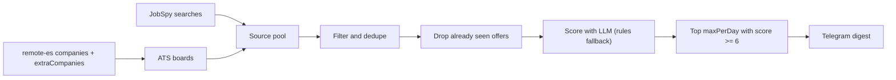

# radar-empleo

Personal job radar. It scans public ATS job boards and job search sites, filters
the offers against a YAML profile, scores the remaining ones with an LLM, and
sends the best matches to Telegram as a daily digest. It never applies to a job
and never logs in to any site.

## How it works



1. Companies come from the remote-es list plus `extraCompanies` in the profile.
   Each company URL is matched to a supported ATS: Ashby, Greenhouse, Lever,
   Workable, Personio or Recruitee.
2. JobSpy searches Indeed and Glassdoor (and LinkedIn only if enabled in the
   profile) for the configured terms.
3. Offers are filtered by title terms, excluded terms, locations, the `applied`
   list and URL/company-title duplicates.
4. Offers already present in `seen.json` are skipped, so nothing is scored or
   sent twice.
5. The rest is scored 0–10 by the LLM when `DEEPSEEK_API_KEY` is set, or by a
   simple rules fallback when it is not.
6. Up to `maxPerDay` offers with a score of at least 6 are formatted into a
   Telegram digest. The seen store is saved right after a successful send.

## Requirements

- Node.js 22 or newer.
- Python 3 with `python-jobspy` (`pip install python-jobspy`), or Docker, which
  installs it in the image.
- A Telegram bot and chat id (only when not using `--dry-run`).
- Optional: a DeepSeek API key for LLM scoring.

## Configuration

Copy the examples and fill in your own values:

- `profile.example.yml` → `profile.yml` (ignored by git). It defines the search
  terms, excluded terms, accepted locations, companies already applied to,
  daily limits, `cvSummary`, JobSpy searches and extra companies.
- `.env.example` → `.env` (ignored by git). The application reads plain
  environment variables; load the file with your shell or process manager.

| Variable | Default | Purpose |
| --- | --- | --- |
| `DATA_DIR` | `/data` | Directory for `seen.json` and `run.lock`. |
| `PROFILE_PATH` | `$DATA_DIR/profile.yml` | Path to the profile YAML. |
| `PYTHON_BIN` | `python3` | Python executable used by JobSpy. |
| `TELEGRAM_BOT_TOKEN` | — | Required unless `--dry-run`. |
| `TELEGRAM_CHAT_ID` | — | Required unless `--dry-run`. |
| `DEEPSEEK_API_KEY` | — | Optional; without it scores come from rules. |
| `DEEPSEEK_BASE_URL` | `https://api.deepseek.com` | OpenAI-compatible endpoint. |
| `DEEPSEEK_MODEL` | `deepseek-chat` | Chat model used for scoring. |

The profile fields are validated with zod at startup; an invalid profile or an
invalid environment stops the run with a clear error.

## Run locally

```sh
npm ci
pip install python-jobspy
cp profile.example.yml profile.yml
cp .env.example .env
export DATA_DIR=./data
export PROFILE_PATH=./profile.yml
npm run dev -- --dry-run
```

`--dry-run` prints the digest and the run summary to the console, does not send
anything, does not write `seen.json` and does not need the Telegram variables.

A real run, limited to three offers:

```sh
export TELEGRAM_BOT_TOKEN=...
export TELEGRAM_CHAT_ID=...
export DEEPSEEK_API_KEY=...   # optional
npm run dev -- --limit 3
```

`--limit N` overrides `maxPerDay` for that run. The production build is:

```sh
npm run build
node dist/main.js
```

The process exits with code 1 and a message without secrets when a fatal error
occurs (missing profile, invalid environment, lock held by another run, Telegram
failure).

## Deploy on Coolify

1. Create an application from this repository and use the `Dockerfile` build
   pack. The image is multi-stage: Node 22 builds the project, then the runtime
   image adds Python and `python-jobspy`, production `node_modules`, `dist` and
   the `jobspy/` script, and runs as the non-root `node` user.
2. Add a persistent volume mounted at `/data`. Put `profile.yml` there (and
   `cv.md`, if you keep one alongside it). `seen.json` and the run lock are also
   stored in that volume, so they survive redeploys.
3. Set the environment variables in Coolify: `TELEGRAM_BOT_TOKEN` and
   `TELEGRAM_CHAT_ID` are required; `DEEPSEEK_API_KEY`, `DEEPSEEK_BASE_URL` and
   `DEEPSEEK_MODEL` are optional. `DATA_DIR=/data` and `PYTHON_BIN=python3`
   already come from the image.
4. Add a Scheduled Task with the cron expression `0 9 * * *` and the command
   `node dist/main.js`. The container command keeps the container alive
   (`tail -f /dev/null`) and every scheduled execution runs that command inside
   it.
5. Deploy. The first build installs the Python dependencies; later runs only
   need the persistent volume and the environment variables.

## Privacy

When `DEEPSEEK_API_KEY` is set, the only data sent to the LLM endpoint is
`cvSummary` from `profile.yml` and the job offer itself (company, title,
location, remote flag and up to 3000 characters of description). Nothing else
from the profile or the volume is transmitted. The digest is sent to the
Telegram chat id you configure. Without an API key no data leaves the process
except the HTTP requests to the job boards and to Telegram.

## Responsible use

- The project reads public job board APIs and the public remote-es list. It does
  not sign in, register, apply or bypass any access control.
- JobSpy scrapes job search sites. Those sites' terms of service may restrict
  automated access; you are responsible for complying with them and with local
  law. Keep the searches few and the runs infrequent.
- LinkedIn is disabled in the default profile. Enabling it may be blocked by
  LinkedIn and is not recommended.
- Run it for your own job search only, with a small number of sources and a
  single daily execution.
